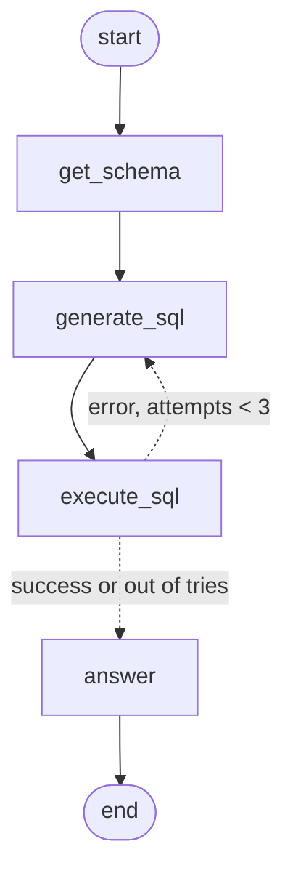

# langGraph-sqlAgent

LangGraph agent that turns natural language questions into SQL, runs them, and fixes its own errors through a generate → execute → retry loop.

[](https://langgraph-sqlagent-bwbqj2pqrnyiaremszmfoo.streamlit.app/)

**Live demo:** https://langgraph-sqlagent-bwbqj2pqrnyiaremszmfoo.streamlit.app/ (no setup or API key needed)

```
> Who are the top 3 customers by total spend?
  [sql #1] SELECT c.name, SUM(o.total) AS spent FROM orders o JOIN customers c ...
Ivan, Omar and Priya are the top three customers by total spend.
```

## How it works



1. **`get_schema`**: reads the table definitions and 2 example rows per table, so the model knows which columns exist and what the values look like.
2. **`generate_sql`**: sends the schema and question to Claude, which writes one SQL query. On a retry, the previous query and its error are added to the prompt so the model can fix it.
3. **`execute_sql`**: rejects anything that isn't a single `SELECT`, then runs the query. A failure is saved as an `error` in the state instead of crashing.
4. **`route`**: decides where to go next. If there was an error and fewer than 3 attempts, it goes back to `generate_sql`. Otherwise it goes to `answer`.
5. **`answer`**: Claude turns the result rows into a plain-English sentence, or the agent explains why it couldn't answer.

**State** is a single dict shared by every node: `question`, `schema`, `sql`, `error`, `attempts`, `columns`, `rows`, `answer`. Each node returns only the fields it changes.

**Safety:** the database is opened read-only, so even a bad query can't change data.

## Web app

A Streamlit chat interface (`app.py`) on top of the same graph:

- **Ask tab:** type a question or click an example prompt. Each answer shows the agent's steps live (reading the schema, writing SQL, retrying on errors), then the plain-English answer with the SQL and result table underneath.
- **Browse data tab:** every table's schema and full contents, so you can check answers yourself.
- **Example prompts** stay at the top and disappear once asked. **Clear chat** (top right) brings them back.
- **Public demo guardrails:** 10 questions per visitor and a 1,024-token cap per model call, to keep API costs predictable.

The app builds the sample database automatically on first run, and `graph.stream()` is what lets it show each node's progress as it happens.

## Project layout

| File | What it does |
|---|---|
| `agent.py` | State, nodes, router and graph: the whole agent |
| `app.py` | Web app (Streamlit): chat with live steps, example prompts, and a data browser |
| `main.py` | Command line: ask one question or keep chatting |
| `data/seed.py` | Builds a sample store database (customers, products, orders) |

## Setup

```bash
python3 -m venv .venv
source .venv/bin/activate
pip install -r requirements.txt
cp .env.example .env          # then put your Anthropic API key in .env
python data/seed.py           # creates data/shop.db (the web app also does this automatically)
```

To deploy your own copy on [Streamlit Community Cloud](https://share.streamlit.io), point it at `app.py` and add `ANTHROPIC_API_KEY = "..."` under the app's **Secrets**.

## Usage

**Web app:**

```bash
streamlit run app.py           # opens http://localhost:8501
```

**Command line:**

```bash
python main.py "Which city has the most customers?"
python main.py                 # interactive mode
python main.py --graph         # print the graph as Mermaid
```

Questions to try:
- How many orders were cancelled?
- What is the best-selling product category by revenue?
- Which customers in Tempe spent more than $1000?
- Average order total per month in 2026?

To use a different model, set `MODEL` in `.env` (default: `anthropic:claude-haiku-5-5`).
